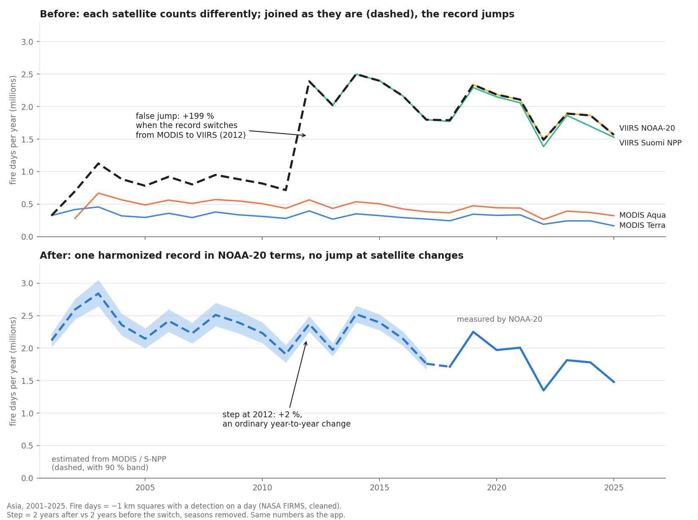
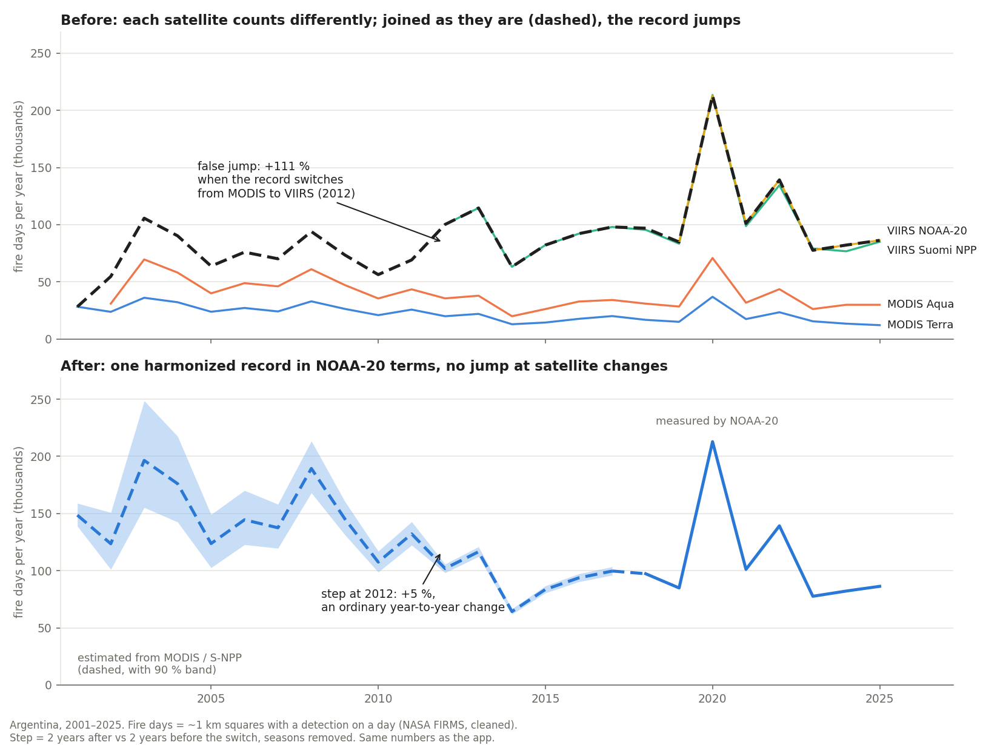
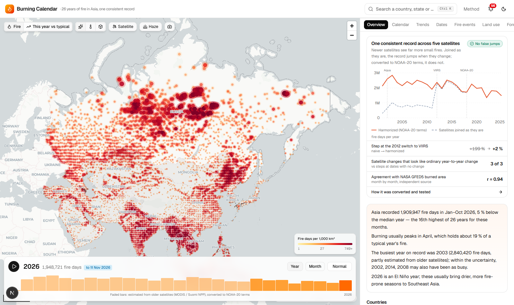
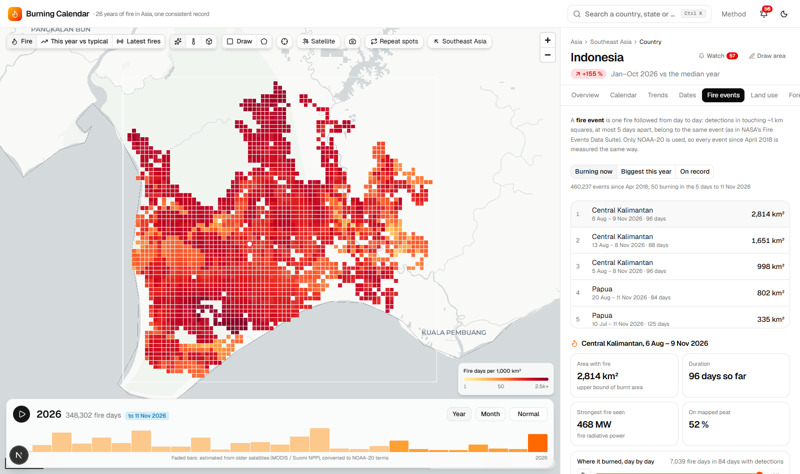
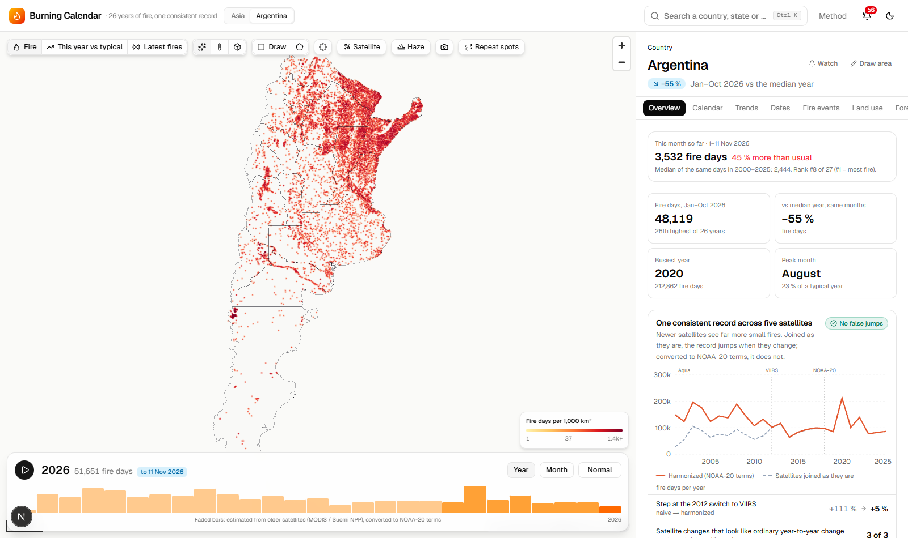
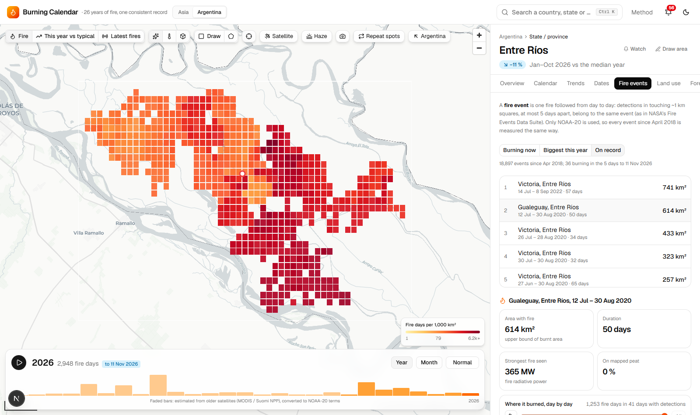

# Harmonized Burning Activity Calendar

**One consistent 26-year fire record from all five NASA fire satellites (MODIS Terra and Aqua; VIIRS Suomi NPP, NOAA-20 and NOAA-21), for all 50 countries of Asia and for Argentina, with an interactive map and burning calendar that answer: when does this place burn, and is this season unusual?**

Built for the NASA Space Apps 2026 challenge *Harmonization of MODIS and VIIRS Hot Spots*, set by CONAE (Argentina's space agency). Deep dive: Malaysia, down to district level. Argentina, the challenge author's country, is included down to its 24 provinces and departments, kept apart from every Asian total.



## The problem, and the result

Newer satellites see far more small fires: VIIRS has 375 m pixels, MODIS about 1 km. If you join their records as they are, fire in Asia appears to jump by **+199 %** when VIIRS arrives in 2012. That jump is an artefact of the satellite change, not a change in fire.

Every month is converted to what **NOAA-20** (the reference satellite, flying since 2018) would have seen. After conversion, the step at 2012 is **+2 %**. That is smaller than 73 % of the ordinary year-to-year steps in the same record. Every converted month carries a 90 % range.

| Check (all of Asia unless stated) | Result |
|---|---|
| Step at the 2012 switch to VIIRS | **+199 %** joined as they are → **+2 %** harmonized |
| Satellite changes that look like ordinary year-to-year change (2002, 2012, 2018) | **3 of 3** |
| Same test in every exported area (51 countries, regions, provinces, districts) | 3,464 of 3,927 ordinary (88 %); flagged ones are named in the app; per-country table in [`docs/seam_table.md`](docs/seam_table.md) |
| Typical error on years hidden from the fit (leave-one-year-out, monthly) | Suomi NPP ±7.8 %, Aqua + Terra ≈ ±12 %, Terra alone ±9.2 % |
| 90 % range contains the true value (hidden years / backcast) | 91–98 % / 93.9 % of 1,269 months |
| Agreement with NASA GFED5 burned area (independent source, monthly) | r = 0.94 |
| Agreement with Indonesia's official burned area (SiPongi, ranking of years) | 0.90 |
| **Argentina:** step at the 2012 switch | **+111 %** joined as they are → **+5 %** harmonized; 3 of 3 satellite changes ordinary |
| **Argentina:** agreement with NASA GFED5 burned area (monthly) | r = 0.97 (provinces 0.43–0.97) |

All of these figures are shown per area in the app (Overview card, Method and Checks tabs), computed by the same code. To regenerate the figure, run `python scripts/plot_harmonization_proof.py`.

### Argentina

The same method, unchanged, on the challenge author's country: the false 2012 jump of +111 % becomes +5 %.



## How the harmonization works

The chain is simple, and every step is tested:

| Period | Source | Conversion fitted on |
|---|---|---|
| Apr 2018 → today | NOAA-20, measured | — |
| 2012 → Mar 2018 | Suomi NPP → NOAA-20 terms | 2018–2026 overlap (twin instrument, small change) |
| NOAA-20 outages | NOAA-21 → NOAA-20 terms | 2024– overlap |
| Jul 2002 → 2011 | Aqua and Terra MODIS, each converted, then averaged (log mean) | 2012–2020, before Aqua's orbit drift |
| Nov 2000 → Jun 2002 | Terra MODIS alone | 2002–2005 |

- **Unit:** ~1 km **fire days**, meaning grid cells with a detection on a local solar date. Gas flares and industrial heat sources are masked.
- **Method contest:** each step picks among M1 fixed ratio, M2 ratio per calendar month, M3 log-linear and M4 quantile mapping. The simpler method wins unless a complex one is clearly better on hidden years (paired 1-SE rule). The Aqua + Terra average was chosen by a backward-in-time test (`scripts/backcast_check.py`).
- **Checks:** for each step, a drift test and an uncertainty band. For each satellite change, a test against placebo dates when nothing changed.
- **Records:** every methodological choice and result is logged in [`docs/decisions.md`](docs/decisions.md).

## The app



- **Map with playback:** harmonized fire by year or month since 2000; the latest real detections; 3D columns and a heat map.
- **Burning calendar:** year × month heat map, each season against its typical year, date ranges, and El Niño years marked.
- **Proof in view:**
  - a consistency card on every Overview
  - the method contest and jump tests in plain words (Method tab)
  - independent checks against GFED5 and official figures (Checks tab)
- **Fire events:** each fire followed day to day (NOAA-20), with its ~1 km squares on the map, a day-by-day slider, and how it ranks against earlier fires.
- **From space:**
  - NASA GIBS satellite photos before and after a fire, with cloud-aware day picking
  - a short-wave infrared view that sees through smoke
  - 30 m Landsat / Sentinel-2 imagery and OPERA vegetation loss
  - a daily haze and smoke layer (VIIRS aerosol optical depth, OMPS aerosol index)
- **Forecast and alerts:** next-week and weeks 2–4 fire outlook per area, tested against simple baselines and using NASA POWER weather; alert rules; a seasonal El Niño outlook.
- **Land:** peat share, oil palm concessions (Sarawak), and places that burn year after year.
- **Your own area:** draw a box or shape, or enter coordinates.
- **Downloads:** CSV and GeoJSON exports, a printable report, map images, and the raw hotspot CSV for any search (85 M detections, filtered in the browser with DuckDB-wasm).







## Limitations

- **Conversions are per area, not per land type.** A user-drawn area reuses its country's conversion, shared out by where the satellites saw fire. Per land cover × peat conversion is planned.
- **12 % of satellite-change tests are flagged** (463 of 3,927 over all areas; 12 of 51 countries have at least one: six desert or island states with few fires (Bahrain, Cyprus, Oman, Qatar, Saudi Arabia, UAE), and Azerbaijan, Bhutan, Laos, Myanmar, the Philippines and Uzbekistan). The app names them on the area's Overview. Some are real changes in fire (El Niño years); some may be leftover satellite effects.
- **Aqua and S-NPP drift.** Their counts drift by +1.5–3.8 % a year against each other at the same overpass time, and the cause is not fully explained. MODIS is only calibrated on years before Aqua's orbit drift.
- **Fire is missed under smoke and cloud.** Thick haze hides fires. The haze layer shows where, but counts are not yet corrected for it.
- **Coverage gaps.** North Korea has no FIRMS country file before 2026. Outside Asia only Argentina is covered so far; it has its own forecast and fire-growth models. CONAE's tools are mapped in [`docs/research/conae-tools.md`](docs/research/conae-tools.md) but not yet used on data.
- **Not yet public.** The app runs locally; a public deployment is planned.

## Run it

```bash
pip install -e ".[dev]"
python -m pytest -q                              # Python tests (synthetic data, no network)
cd web && npm install && npm test && npm run dev # web app at http://localhost:3000
```

Full data pipeline (all of Asia; downloads need no key except the current year's NRT data):

```bash
python scripts/download_country_files.py --region asia      # FIRMS per-country files 2000–2025
python scripts/download_firms.py --bbox sea --source VIIRS_NOAA20_SP VIIRS_NOAA20_NRT --start 2026-01-01 --end <today>
python scripts/download_context.py --peat --gfed --concessions
python scripts/build_static_mask.py && python scripts/build_cube.py && python scripts/build_daily.py
python scripts/build_events.py && python scripts/build_fine_cells.py
python scripts/download_weather.py && python scripts/build_forecast.py
python scripts/export_web.py && python scripts/build_event_dots.py && python scripts/export_points.py
python scripts/update_daily.py                                # daily refresh of all of the above
```

The current-year download needs a free FIRMS MAP_KEY in `.env` (`FIRMS_MAP_KEY=...`). Run heavy steps one at a time on a 16 GB machine. More detail is in [`web/README.md`](web/README.md) and [`docs/planning/getting-started.md`](docs/planning/getting-started.md).

## Repository layout

```
src/burncal/   Python package: cleaning, harmonization chain, benchmark and seam tests, calendar,
               regions, events, forecast, alerts, weather, burned-area and official checks
scripts/       downloads, cube build, pipeline, web export, figures, daily update
tests/         pytest suite (synthetic data only)
web/           Next.js app (static export; MapLibre + deck.gl, DuckDB-wasm), Vitest tests
docs/          decisions log, per-country seam table, CONAE tools notes, figures, demo video
```

## Data and credits

- **NASA FIRMS:** MODIS Collection 6.1 and VIIRS 375 m active fire (S-NPP, NOAA-20, NOAA-21).
- **NASA GIBS:** VIIRS / MODIS corrected reflectance, HLS Landsat / Sentinel-2, OPERA DIST-ALERT, Deep Blue aerosol optical depth, OMPS aerosol index.
- **Weather:** NASA POWER daily weather.
- **Burned area:** GFED5.
- **Official figures:** SiPongi (Indonesia, Ministry of Environment and Forestry).
- **Boundaries and context:** geoBoundaries / OpenStreetMap; NOAA CPC El Niño index; CIFOR peat map; ASMC haze reviews.
- **Challenge author:** CONAE (Comisión Nacional de Actividades Espaciales).

Licensed MIT; see [`LICENSE`](LICENSE). FIRMS and GIBS data are NASA open data; please cite the sources above when using the outputs.
